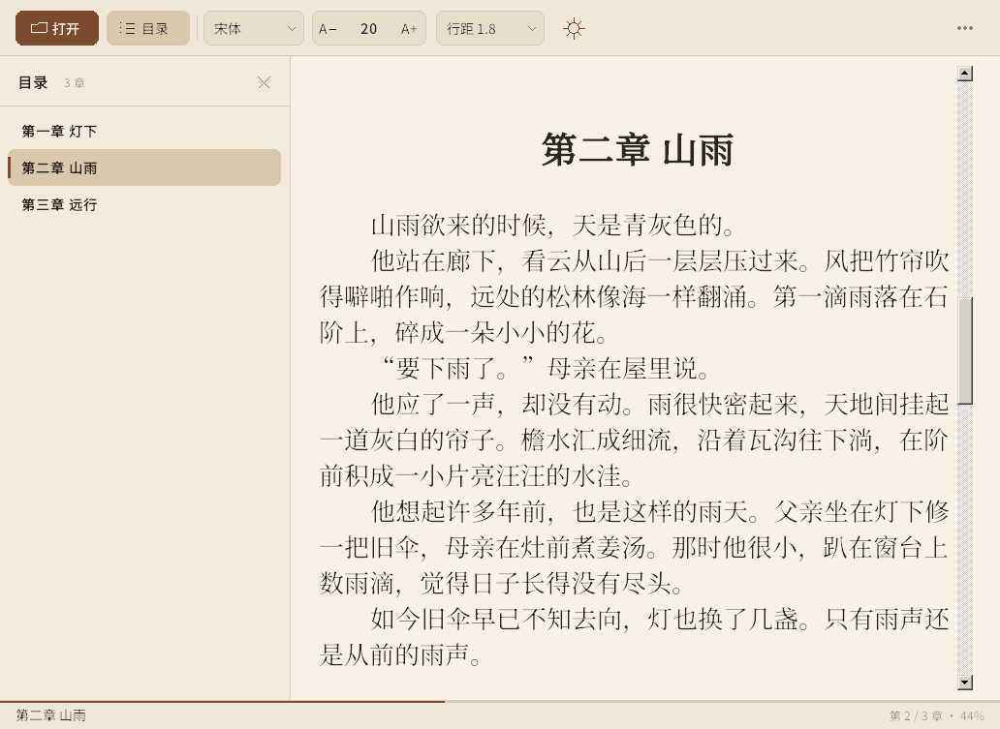

# 墨阅 · MoYue

[](https://github.com/Lossalt/moyue/releases/latest)
[](https://github.com/Lossalt/moyue/releases/latest)
[](LICENSE)

一个为长篇中文小说设计的 Windows EPUB 阅读器：轻量、单文件、完全离线。

> **下载**：[最新版 `墨阅.exe`](https://github.com/Lossalt/moyue/releases/latest)（单文件，约 16 MB，无需安装）



## 特点

- **单文件绿色版**：只有一个 `墨阅.exe`，不需要安装，不依赖 .NET / WebView2 / Electron，也没有额外 DLL。约 16 MB。
- **内嵌三款开源中文字体**，不挑系统字体：
  - 宋体：思源宋体（Noto Serif SC）
  - 黑体：思源黑体（Noto Sans SC）
  - 楷体：霞鹜文楷屏幕版（LXGW WenKai Screen）
- **排版可调**：字号 13–40 pt、行距 1.2–3.0，实时生效并保持阅读位置。
- **三种主题**：纸黄、青瓷（护眼）、夜读；Windows 标题栏同步深浅色。
- **目录侧栏**：支持 EPUB 2 NCX 与 EPUB 3 nav，多级目录缩进，点击跳转。
- **阅读进度**：底部显示章节与百分比；退出后记住上次的书、位置和排版设置。
- **全屏阅读**：`F11` 进入，`Esc` 退出，隐藏工具栏与状态栏。
- **多种打开方式**：按钮选择、`Ctrl+O`、拖放 EPUB 到窗口、命令行参数。
- 支持 UTF-8 / GBK / UTF-16 编码的 XHTML，Per-Monitor V2 高 DPI。

## 使用

1. 双击 `墨阅.exe`。
2. 点击「打开一本 EPUB」，或把 `.epub` 文件拖进窗口。
3. 工具栏从左到右：打开、目录、字体、字号 `A− / A+`、行距、主题、更多。

### 快捷键

| 快捷键 | 功能 |
|---|---|
| `Ctrl+O` | 打开 EPUB |
| `Ctrl+T` | 显示 / 隐藏目录 |
| `Ctrl+=` / `Ctrl+-` | 放大 / 缩小字号 |
| `Ctrl+0` | 恢复默认字号（19 pt） |
| `Ctrl+←` / `Ctrl+→` | 上一章 / 下一章 |
| `Alt+←` / `Alt+→` | 上一章 / 下一章 |
| `Ctrl+滚轮` | 调整字号 |
| `F11` | 全屏阅读 |
| `Esc` | 退出全屏 / 关闭对话框 |
| `F1` | 快捷键帮助 |

### 配置文件

设置保存在：

```text
%APPDATA%\MoYue\settings.json
```

包括字体、字号、行距、主题、窗口位置、最近阅读的书和每本书的进度。删除该文件即可恢复默认设置。

## 截图

| 夜读主题 | 欢迎页 |
|---|---|
|  |  |


## 兼容性与限制

- 面向 **Windows 10 / 11 x64**。
- 支持 EPUB 2 / EPUB 3、NCX / nav 目录、嵌套目录、UTF-8/GBK/UTF-16 文本。
- 不打开带 DRM / 加密的 EPUB。
- 当前是**纯文字阅读器**：不渲染封面和书内图片，图片位置会显示「〔插图〕」；不解析 CSS、复杂版式、固定版式（漫画类）EPUB。
- 目录若指向同一个 XHTML 内的多个锚点，会跳到该文件的开始处（常见小说通常一章一个 XHTML，不受影响）。
- 内嵌字体是子集，覆盖《通用规范汉字表》8105 字及常用标点、拉丁字母；极生僻字会回退到系统字体。
- 未签名程序首次运行时，Windows SmartScreen 可能提示。可选择「更多信息 → 仍要运行」。

## 从源码构建

要求：

- Go 1.26+（本项目使用 Go 1.27 构建）
- [`go-winres`](https://github.com/tc-hib/go-winres)：用于写入图标、版本信息和 DPI 清单

```bash
go install github.com/tc-hib/go-winres@latest

# Linux / macOS 交叉编译
./build.sh

# Windows PowerShell
.\build.ps1
```

输出：

```text
dist/墨阅.exe
```

也可以直接：

```bash
go test ./...
go-winres make --arch amd64
GOOS=windows GOARCH=amd64 CGO_ENABLED=0 go build -trimpath \
  -ldflags "-H windowsgui -s -w" -o "dist/墨阅.exe" .
```

### 代码结构

| 文件 | 作用 |
|---|---|
| `epub.go` | EPUB 容器、OPF、NCX / nav、编码解码 |
| `text.go` | XHTML → 段落 / 行内样式，中文空白与标点处理 |
| `document.go` | 合并章节、UTF-16 偏移、行间定位 |
| `reader.go` | RichEdit 排版、字号 / 行距 / 颜色、滚动定位 |
| `win32.go` | Win32 / GDI / RichEdit 绑定 |
| `ui_paint.go` | 工具栏、状态栏、欢迎页、对话框 |
| `menu.go` / `toc.go` / `dialog.go` | 自定义菜单、目录、对话框 |
| `fonts/` | 子集化后的内嵌字体 |

## 字体授权

三款字体均以 **SIL Open Font License 1.1** 授权，允许嵌入、再分发与子集化。版权与完整授权文本见：

- [`licenses/OFL-Noto.txt`](licenses/OFL-Noto.txt)
- [`licenses/OFL-LXGWWenKai.txt`](licenses/OFL-LXGWWenKai.txt)
- [`THIRD_PARTY_NOTICES.md`](THIRD_PARTY_NOTICES.md)

字体子集化仅保留阅读所需字符，未修改字形轮廓。

## 代码授权

MIT License，见 [`LICENSE`](LICENSE)。
