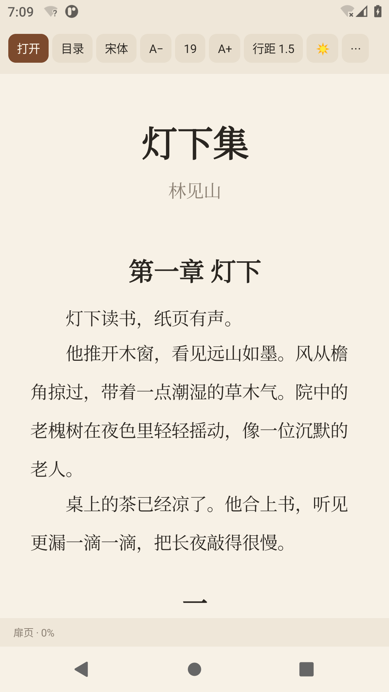
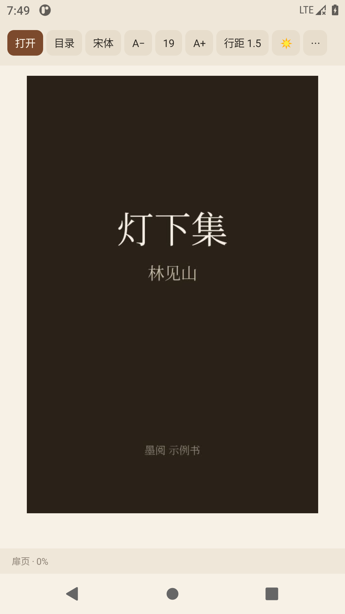

# 墨阅 Android 版

轻量、离线、无广告的 EPUB 小说阅读器。纯 Android 原生 View，不使用 AndroidX / Compose / WebView，APK 约 6.8 MB。

- 最低 Android 8.0（API 26），targetSdk 34
- 内嵌思源宋体、思源黑体、霞鹜文楷
- 字号 13–40 pt、行距 1.2–3.0
- 纸黄 / 青瓷 / 夜读三主题
- 封面页、正文插图，点击可全屏查看并左右切换
- EPUB 2 NCX / EPUB 3 nav 目录，多级缩进
- 自动记住上次的书、阅读位置和排版设置
- 通过系统文件选择器（SAF）打开 EPUB，不需要存储权限





## 构建

不需要 Gradle 和 Android Studio。需要：

- JDK 17+（本机用 JDK 21）
- Android SDK Platform 35
- Android SDK Build-Tools 35.0.0

```bash
# 例如 SDK 在 ~/Android/Sdk
export ANDROID_SDK_ROOT=$HOME/Android/Sdk
./build_apk.sh
```

输出：

```text
../dist/MoYue.apk
```

构建脚本会执行 `aapt2 → javac → d8 → zipalign → apksigner`，并打印签名/包信息。

### 签名

脚本默认读取仓库根目录的 `.android-keystore/moyue.jks` 和 `.android-keystore/pass`（已在 `.gitignore` 中忽略）。首次构建可这样生成：

```bash
mkdir -p ../.android-keystore
PASS=$(openssl rand -hex 16)
printf '%s' "$PASS" > ../.android-keystore/pass
keytool -genkeypair -keystore ../.android-keystore/moyue.jks -alias moyue \
  -keyalg RSA -keysize 2048 -validity 10000 \
  -storepass "$PASS" -keypass "$PASS" \
  -dname "CN=MoYue, OU=MoYue, O=MoYue, C=CN"
```

也可以使用环境变量：

```bash
export ANDROID_KEYSTORE=/path/to/release.jks
export ANDROID_KEY_ALIAS=moyue
export MOYUE_KEYSTORE_PASS=...
./build_apk.sh
```

> `dist/MoYue.apk` 使用本地 release keystore 签名；请妥善保存 keystore，后续升级必须使用同一个签名。

## 目录

```
android/
├── AndroidManifest.xml
├── res/font/                      内嵌字体
├── res/mipmap-*/                  启动图标
├── src/com/lossalt/moyue/
│   ├── MainActivity.java          界面、工具栏、文件选择、设置
│   ├── ReaderAdapter.java         阅读列表与排版
│   ├── Epub.java                  EPUB 容器/OPF/NCX/nav/图片/XHTML 解析
│   ├── ImageUtil.java             图片采样、EXIF 旋转
│   └── Theme.java                 三套主题
├── test/com/lossalt/moyue/
│   └── ParserSmoke.java           JVM 解析冒烟测试
└── build_apk.sh
```

解析器不依赖 Android API，可以单独在 JVM 上测试：

```bash
mkdir -p build/testclasses
javac -encoding UTF-8 -source 8 -target 8 -d build/testclasses \
  src/com/lossalt/moyue/Epub.java test/com/lossalt/moyue/ParserSmoke.java
java -cp build/testclasses com.lossalt.moyue.ParserSmoke ../examples/灯下集.epub
```

## 已知限制

- 不解析 CSS，复杂版式/固定版式（漫画）EPUB 可能无法正确显示。
- SVG 图片暂不渲染；JPEG / PNG / GIF / WebP / BMP 可直接显示。
- 不支持 DRM。
- 目录指向同一个 XHTML 内多个锚点时只跳文件开头（常见一章一文件的小说不受影响）。
- 内嵌字体为子集，极生僻字会回退到系统字体。
